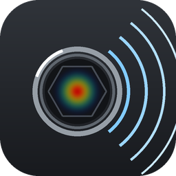
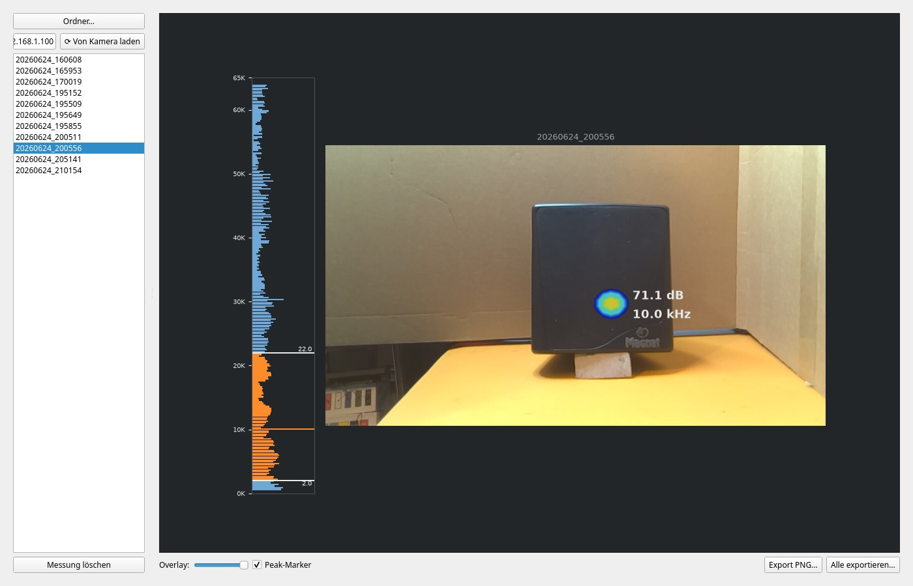

# lnx-isocam

A standalone Linux desktop client for the **Crysound SonoCam Pocket CRY8024**
acoustic camera. Python + PySide6/Qt, nothing else required at runtime but a
network route to the camera.

This is the desktop counterpart my (inofficial) Sailfish OS app
[iSoCam](https://github.com/JimKnopfIoT/harbour-isocam). The two are separate
programs: this one has its own Qt Widgets interface and renders with matplotlib,
the phone app is Silica/QML and renders with Pillow. They share only the knowledge
of the camera's HTTP interface and its file formats — which is what was worked out
here in the first place.



## What it does

- **Messungen** — browse a local copy of the measurements and see the combined
  analysis: camera photo with the acoustic overlay, the loudest spot with its dB
  and exact calibrated peak frequency, and a dB-scale spectrum-bar graph with
  draggable band handles. Export a single PNG or all of them at once.
- **Live** — the camera's HTTP feed at roughly 3–4 fps with the current dB and the
  last peak. Auto-Capture downloads a measurement as soon as the camera saves one.
- **Files** — browse and pull the camera's storage over its HTTP interface.

The "Messungen" tab works entirely offline on a local copy; only Live, Files and
the sync need the camera on the same network.

## Requirements

Python 3.11 or newer with **PySide6**, **numpy**, **matplotlib** and **Pillow**.

## Run

```bash
python3 app.py
```

The camera's address is entered in the UI — the value compiled in is only a
placeholder and will not reach anyone's camera.

## Tools

- `tools/backup.py` — mirror the camera's storage to a local directory
  (`--manifest` lists sizes only, `--pull` downloads).
- `tools/calibrate_freq.py` — refit the `.doa` spectrum's frequency axis from
  recordings of known tones and write `freq_calib.json`.

## How the camera stores a measurement

Each measurement is one directory under `imager/Default/<YYYYMMDD_HHMMSS>/`, split
across several files:

| File | What it holds |
|------|---------------|
| `<ts>_1.jpg` | the optical camera photo, 1280 × 720 |
| `<ts>_0.jpg` | the acoustic overlay — 800 × 480, ~99 % transparent |
| `<ts>.doa` | text header plus binary: a 32 × 24 direction-of-arrival grid and a 3201-bin power spectrum |
| `info.json` | the selected band, the detected peaks as `{x, y, dB}`, max dB SPL, scenario, distance |
| `<ts>.wav` | the recording, mono 16-bit at roughly 130 kHz |

The camera itself never draws these together into one image — that view exists only
live on its own screen. Composing them is what this client is for.

One catch: the `.doa` power spectrum is stored **backwards** — bin 0 is the Nyquist
end at 65 kHz, not 0 Hz. The axis was calibrated against an SDG6022X signal
generator; the fit lives in `freq_calib.json` and is applied on read.

See [`docs/API.md`](docs/API.md) for the HTTP endpoints.

## udev rule

`99-isocam.rules` (installed to `/etc/udev/rules.d/`) gives non-root adb access,
stable `/dev/isocam-*` symlinks, and suppresses the "rk3576 cannot be mounted"
auto-mount popup. Optional — it only matters when the camera is attached over USB.

## USB modes

The camera's two USB personalities are **not** active at the same time; switch on
its touchscreen:

- **Webcam mode** → `eba4:7588` → appears as a UVC camera on `/dev/video*`
- **File mode** → `2207:xxxx` (`rk3576`) → an adb gadget

In practice WiFi is the useful channel: USB has no user-selectable file mode, and
adb only appears during a short window at boot.

> **Not affiliated with, endorsed by, or connected to Crysound.** "Crysound",
> "SonoCam" and any product names are trademarks of their respective owners and are
> used here only descriptively, to identify the hardware this client works with.
